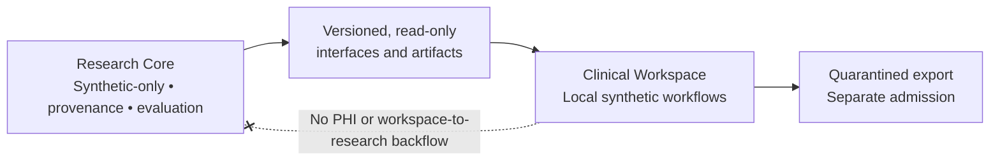

<!-- markdownlint-disable MD033 MD041 -->
<div align="center">

# MedOrigin

**Every medical AI output deserves an origin.**

Evidence-native medical AI research infrastructure and a local-first clinical workspace foundation.

[](https://github.com/AbdulazizShehri/MedOrigin/actions/workflows/ci.yml)
[](https://github.com/AbdulazizShehri/MedOrigin/actions/workflows/codeql.yml)
[](LICENSE)
[](pyproject.toml)
[](ROADMAP.md)

[Overview](#overview) · [Architecture](#architecture) · [Get started](#get-started) · [Documentation](#documentation) · [Community](#community) · [Contribute](CONTRIBUTING.md)

</div>

> [!IMPORTANT]
> **Research software, not a medical device.** No production clinical use, real-patient/PHI ingestion, autonomous diagnosis, or EHR write capability is authorized. The supported development and evaluation path is synthetic-only. Do not interpret an implemented module or passing CI as clinical or scientific validation.

## Overview

MedOrigin is an open-source foundation for **traceable medical AI**: reproducible research workflows, source-linked evidence, deterministic verification, FHIR interoperability contracts, and privacy-conscious clinical-workspace infrastructure.

Our design question is simple: *What evidence produced this output, what was inferred, and can an independent reviewer reproduce the result?*

Rather than starting with a chatbot interface, MedOrigin starts with explicit data boundaries, inspectable artifacts, typed contracts, and falsifiable tests.

## What exists today

| Area | Implemented foundation | Important boundary |
| --- | --- | --- |
| **Evidence & literature** | Provenance, screening, reproducible literature workflows, research artifacts | Evidence infrastructure is not itself a verified medical answer service |
| **Evaluation & research** | Deterministic benchmark/scoring contracts, replay, governed research-loop framework | Real GPU feasibility, training, and model promotion require separate evidence and authorization |
| **FHIR** | Deterministic validation, bounded FHIR R4 import/export contracts | Structural validity does not establish clinical correctness |
| **Clinical Workspace** | Local Python APIs for synthetic encounters, drafts, review, evidence, timeline/graph, dataset staging, analytics, and encrypted storage | **No general-purpose desktop/web GUI or PHI-ready production workflow** |
| **Trust & privacy** | One-way Research/Workspace boundary, integrity/audit controls, quarantined export semantics | Patient/workspace data cannot flow into Research Core training or benchmarks |

### Architecture



The **Research Core** is independently packaged under `src/medscale/`. The separate **Clinical Workspace** foundation lives in `apps/workspace/`. Import boundaries and no-backflow rules are tested; deployment and real patient-data permissions are separate governance decisions.

## Project status

MedOrigin is **an active research platform**, not a finished clinical product.

- **Engineering:** Clinical Workspace units `CW-000` through `CW-020` are canonically closed for their authorized synthetic-only scope. `CW-021` has **not** been authorized.
- **Scientific readiness:** `MRL-0809` (trusted real-runtime feasibility) and `MRL-0899` (real-experiment readiness) are still open. Scientific success is not inferred from test success.
- **Free GPU routes:** Colab Recovery-3 is stopped after a consumed, failed preflight exception; Kaggle remains separately governed and unqualified for scientific execution.
- **Release:** The existing Python distribution and command remain `medscale` for compatibility. The **MedOrigin** branding does not rename frozen protocols or previously published artifacts.

See the [canonical roadmap](ROADMAP.md), [research task ledger](specs/mesc-research-loop-v1/tasks.md), [workspace task ledger](specs/medscale-clinical-workspace-v1/tasks.md), and [brand transition policy](docs/BRAND_TRANSITION.md). Those sources and their exact verification records take precedence over this summary.

## Get started

Requirements: Python 3.11+ (the package currently supports 3.11–3.14), [uv](https://docs.astral.sh/uv/), and Git.

```bash
git clone https://github.com/AbdulazizShehri/MedOrigin.git
cd MedOrigin
uv sync
uv run medscale --help
uv run pytest
uv run ruff check .
uv run ruff format --check .
uv run mypy
```

The `medscale` CLI and Python import paths are **intentional compatibility names**; they are not an alternative product identity. The Clinical Workspace is a separate local Python package and currently provides a synthetic offline shell, **not a user-ready browser or desktop application**.

## Documentation

| Start here | Why |
| --- | --- |
| [Documentation index](docs/README.md) | Architecture, research, data, governance, and technical guides |
| [Research vision](docs/vision/MEDSCALE_RESEARCH_VISION.md) | Scientific scope and permanent limits |
| [Clinical Workspace specification](specs/medscale-clinical-workspace-v1/README.md) | Product modules, security, and planned journeys |
| [Research Loop specification](specs/mesc-research-loop-v1/README.md) | Evidence-first execution model and scientific gates |
| [Brand transition](docs/BRAND_TRANSITION.md) | MedOrigin identity, legacy package names, and migration policy |
| [Synthetic-only software release track](docs/releases/software_release_track.md) | Independent package/developer-preview gate; separate from scientific and clinical qualification |
| [Developer package install guide](docs/releases/developer_package_install.md) | Independently build and smoke the Core and Workspace Python wheels using synthetic data only |
| [Third-party provenance](THIRD_PARTY_NOTICES.md) | Attribution and rules for using external sources |

## Community

MedOrigin is openly developed: feedback, reproducible bug reports, documentation, accessible onboarding, interoperability discussions, and carefully reviewed code contributions are welcome. You do **not** need a medical or machine-learning background to help with developer experience, tests, and documentation.

- **Ask questions and propose ideas:** [GitHub Discussions](https://github.com/AbdulazizShehri/MedOrigin/discussions) and [support options](SUPPORT.md).
- **Report bugs or propose improvements:** [GitHub Issues](https://github.com/AbdulazizShehri/MedOrigin/issues/new/choose). Please never post patient data, credentials, or security vulnerabilities in public issues.
- **Make a contribution:** read [CONTRIBUTING.md](CONTRIBUTING.md) and use a focused pull request with reproducible checks.
- **Understand project decisions:** [Community governance](GOVERNANCE.md), [Code of Conduct](CODE_OF_CONDUCT.md), and [research rules](docs/governance/rules.md).
- **Explore the work:** see the [roadmap](ROADMAP.md) and [documentation index](docs/README.md) for implemented, planned, and gated work.

Changes affecting clinical claims, scientific evidence, model promotion, or data boundaries receive additional review. Open participation does **not** imply clinical readiness or permission to use real patient data.

**Security reports belong in [private vulnerability reporting](https://github.com/AbdulazizShehri/MedOrigin/security/advisories/new), not public issues.**

## License & citation

This repository is distributed under [Apache-2.0](LICENSE), subject to any file-level third-party notices and the licenses of optional external model or dataset artifacts. Permissions for source reuse do **not** remove legal attribution or license obligations. See [THIRD_PARTY_NOTICES.md](THIRD_PARTY_NOTICES.md) and [CITATION.cff](CITATION.cff).

*Compatibility and research-history identifiers are documented in the [identity policy](docs/BRAND_TRANSITION.md); attribution and reproducibility records are preserved.*
