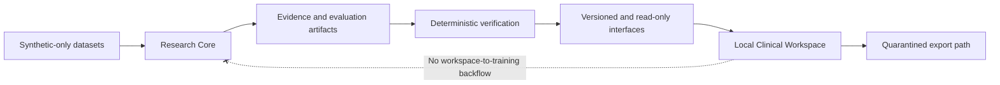

# MedOrigin architecture

**Status:** Current architectural overview
**Audience:** Contributors, maintainers, and research engineers

MedOrigin is organized around verifiable outputs, explicit data boundaries,
reproducible scientific artifacts, and local-only synthetic workflows. The
architecture is intentionally smaller than the project roadmap: a module or
specification existing in the repository is not proof that a model, clinical
workflow, or distribution has passed its admission gates.

## System at a glance

**Research Core** contains research evidence handling, reproducibility
contracts, deterministic benchmark execution, model/runtime qualification
records, and validated interoperability. The existing Python import package
is `medscale`, retained for compatibility.

**Clinical Workspace** provides local Python contracts for *synthetic-only*
encounter data, review state, timelines, bounded analytics and encrypted
storage. The current workspace is neither a general-purpose desktop/web
application nor authorized for real clinical deployment.

The data boundaries are one-way: no real-patient content, workspace data, or
clinical output may silently become model training or benchmark inputs.

## Where to find the implementation

| Concern | Repository area | Current interpretation |
| --- | --- | --- |
| Research Core | [`src/medscale/`](../../src/medscale/) | Compatibility package and research implementation |
| Workspace | [`apps/workspace/`](../../apps/workspace/) | Local synthetic-only interfaces |
| Technical contracts | [`specs/`](../../specs/) | Specs, task evidence, explicit acceptance gates |
| Tests | [`tests/`](../../tests/) | Executable checks; not clinical validation |
| Engineering policies | [`docs/governance/`](../governance/) | Research integrity and decision rules |
| Architecture decisions | [`docs/adr/`](../adr/) | Original evidence of approved and proposed decisions |
| Release qualification | [`docs/releases/`](../releases/) | Software packaging and separate publication boundaries |

## Design principles

1. **Evidence before claims.** Outputs declare their inputs, verification
   status, version, and any uncertainty or abstention.
2. **Deterministic where possible.** Replayable tests and fixtures form the
   primary qualification route. Model judgments are not substitutes for
   executable benchmark metrics.
3. **Privacy is a boundary, not a promise.** Synthetic-only research inputs,
   local workspace isolation, and explicit rejection of unauthorized export.
4. **Compatibility is intentional.** Public presentation uses MedOrigin.
   Existing identifiers used by Python packages, research protocols and
   immutable records cannot be renamed without compatibility evidence.
5. **Provenance is preserved.** Original citations and licenses remain
   available even when the public navigation focuses on MedOrigin's own
   capabilities.

## Current limits

MedOrigin is **research software, not a medical device**. There is no
authorization for real-patient/PHI data, autonomous diagnosis, production
EHR write access, or scientific promotion based only on CI. Trusted GPU/runtime
feasibility and real-experiment readiness still have open gates; consult the
[project roadmap](../../ROADMAP.md) and canonical research specifications
before claiming any outcome.

## Contribute

Read the [developer guide](../guides/developer_guide.md),
[contribution guide](../../CONTRIBUTING.md),
[community governance](../../GOVERNANCE.md) and
[security policy](../../SECURITY.md). Propose architecture changes through
an issue or ADR, with a test plan and explicit data-boundary considerations.
